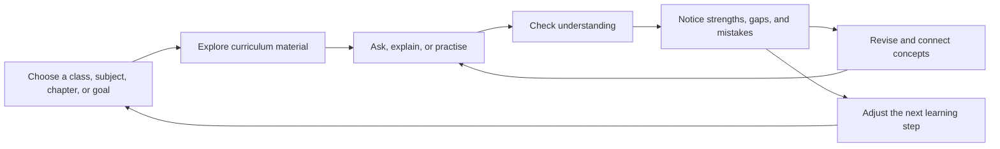
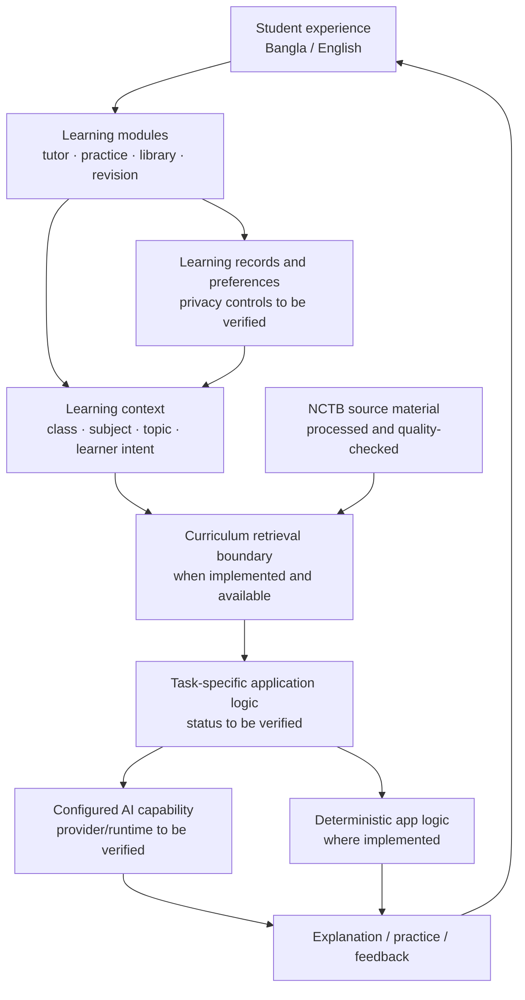

# IntelliHorizon

### A curriculum-grounded, learner-centered AI learning platform for Bangladesh

**IntelliHorizon is designed to help students in NCTB Classes 6–10 understand, practise, remember, and connect what they learn—in Bangla or English.** It brings tutoring, assessment, revision, curriculum resources, and learner insight into one educational product vision.

> **Project status and evidence**  
> This README describes the established product direction and named module inventory. It does not imply that every capability is implemented or available in a production deployment. The repository and implementation could not be inspected in the project materials available for this document. Feature maturity is therefore stated conservatively, and historical data-processing figures are explicitly dated as snapshots rather than current guarantees.

[Repository](https://github.com/sabiha-nib/intellihorizon) · **Audience:** NCTB Classes 6–10 · **Languages:** Bangla and English

---

## Contents

- [What IntelliHorizon is](#what-intellihorizon-is)
- [Product principles](#product-principles)
- [Feature inventory](#feature-inventory)
- [Feature maturity and evidence](#feature-maturity-and-evidence)
- [Curriculum and data foundation](#curriculum-and-data-foundation)
- [AI behavior and learning design](#ai-behavior-and-learning-design)
- [Conceptual architecture](#conceptual-architecture)
- [Privacy, safety, and governance](#privacy-safety-and-governance)
- [Quality, evaluation, and observability](#quality-evaluation-and-observability)
- [Limitations and open questions](#limitations-and-open-questions)
- [Repository facts and development environment](#repository-facts-and-development-environment)
- [Getting started](#getting-started)
- [Deployment and operations](#deployment-and-operations)
- [Reproducibility and contribution](#reproducibility-and-contribution)
- [Roadmap framing](#roadmap-framing)
- [Acknowledgements and licensing](#acknowledgements-and-licensing)

## What IntelliHorizon is

School learning is not a single interaction. A student may need a patient explanation, a short practice set, a way to revisit a misconception, a map of connected ideas, and a realistic view of progress. IntelliHorizon is the product vision for bringing those jobs together around the learner and the curriculum.

The target curriculum context is **Bangladesh's National Curriculum and Textbook Board (NCTB), Classes 6–10**, across **Bangla- and English-medium learning experiences**. Curriculum-grounded retrieval is a core product objective: when a feature depends on curriculum evidence, it should use relevant textbook or curriculum material and make uncertainty visible when evidence is absent or weak.

IntelliHorizon is intended to support learning rather than replace teachers, textbooks, guardians, or student judgment. Its north star is durable understanding, not merely answer production.

### The intended learning loop

This diagram describes the product model, not a claim that the full loop is currently integrated in a released application.

## Product principles

1. **Curriculum before confident-sounding answers.** Learning assistance should be scoped to the learner's class, subject, topic, language, and available curriculum evidence.
2. **Teach for understanding.** Prefer hints, questions, worked reasoning, retrieval practice, and reflection to simply giving away an answer.
3. **Adapt presentation, preserve correctness.** Persona and difficulty may change the explanation; they must not change academic facts.
4. **Make progress legible.** Show what a learner has practised and what evidence supports a recommendation. Avoid implying that a score fully measures ability.
5. **Respect student privacy.** Minimize personal information, keep learner data appropriately separated, and explain where processing occurs. These are requirements and design principles, not a certification claim.
6. **Be honest about uncertainty.** “Zero Hallucination” is an aspiration for grounded, cautious behavior—not a guarantee that a model can never be wrong.
7. **Design for access.** Bangla and English are first-class product languages. Offline-first/PWA behavior is an intent that must be verified for each feature and release.

## Feature inventory

The following is the **complete named IntelliHorizon feature inventory currently established in product context**. Descriptions explain intended roles. A name in this table is not evidence of implementation, integration, availability, or validation; consult [Feature maturity and evidence](#feature-maturity-and-evidence).

| Module | Intended role |
|---|---|
| **IntelliTutor** | Curriculum-grounded tutoring with explanations, follow-up questions, and guided problem solving. |
| **PersonaShift** | Adjusts the teaching voice, explanation style, or level of detail to suit a learner's preference while preserving accuracy. |
| **Learning Library** | Organizes learning resources around class, subject, chapter, and topic. |
| **TopicWise** | Supports focused learning and practice around a specific topic. |
| **IntelliQuiz** | Provides quiz and formative assessment experiences. |
| **HorizonPath** | Helps structure a learner's next steps toward a learning goal. |
| **SmartRevision** | Supports review and retrieval practice over time. |
| **Learning Twin** | Represents relevant learner context and learning history for personalization, subject to privacy and data controls. |
| **KnowledgeMap** | Makes topics and knowledge relationships easier to explore. |
| **ConceptConnect** | Helps learners relate ideas across topics or subjects. |
| **FormulaVault** | Provides a focused way to review formulas and associated learning context. |
| **ExamArena** | Offers exam-oriented practice and assessment experiences. |
| **Learning Analytics** | Summarizes learning activity and progress indicators for the learner. |
| **IntelliXP** | Represents learning participation or achievement through an experience/progression layer. |
| **MemoryCards** | Supports flashcard-style recall and review. |
| **SmartNotes** | Helps capture and organize study notes. |
| **IntelliSummary** | Produces concise learning summaries from relevant material. |
| **Explain It Back** | Invites learners to explain an idea in their own words as a check for understanding. |
| **Reflection** | Prompts learners to reflect on their learning process, confidence, or next steps. |
| **Multimodal Desk** | Provides a learning workspace intended to handle more than one content or input modality. Exact supported modalities require implementation verification. |
| **Mistake Replay** | Lets learners revisit errors and the reasoning around them as a learning opportunity. |
| **Weak Spots** | Helps identify topics that may need more practice based on available learning evidence. |

### Product capabilities that cross modules

These are product-wide capabilities and educational approaches, not additional claims about shipped components:

- **Bangla and English learning experiences** for the target NCTB context.
- **Curriculum-grounded retrieval** intended to connect answers and activities to relevant source material.
- **Socratic questioning** to encourage learners to reason through a problem.
- **Bloom's Taxonomy** as a learning-design reference for varying cognitive demand—from recall and understanding through application, analysis, evaluation, and creation.
- **Offline-first/PWA intent** to make learning more resilient where connectivity is limited.
- **Student privacy and safety principles** appropriate to a school-age audience.

### Explicit exclusions

IntelliHorizon documentation must not absorb features belonging to MillionX. The following are **not IntelliHorizon modules** and are intentionally excluded: **KnowledgeSpy, Blind Spot Mirror, Knowledge Autopsy, Study Momentum Engine, and Future You Snapshot**.

## Feature maturity and evidence

Product inventories often mix prototypes, plans, and production capabilities. IntelliHorizon documentation should keep those states distinct.

| Evidence class | What it means here |
|---|---|
| **Repository fact** | A fact explicitly established about the public repository or development environment. It does not imply release readiness. |
| **Historical validation snapshot** | A dated or earlier processing/reporting result. It is useful context, but may no longer describe current data or code. |
| **Designed / intended** | A named capability or product behavior in the established product direction. No implementation claim follows from the name alone. |
| **Implemented / verified** | May be claimed only when the current repository, running application, or reproducible evidence demonstrates the capability. |
| **Production / deployed** | May be claimed only with evidence of a live deployment and its operating configuration. No such deployment status is asserted in this README. |

**Current documentation boundary:** the available project directory contained no application source files to inspect. Accordingly, this README does not mark individual modules as implemented or production-ready. Before release, maintainers should update this section with verifiable evidence such as repository paths, reproducible steps, release identifiers, and known gaps.

### Historical curriculum-processing snapshot

Earlier product reporting recorded the following processing snapshot:

| Reported item | Historical value |
|---|---:|
| Pages processed for OCR | 1,181 |
| Subjects | 8 |
| Offerings | 16 |
| Books | 9 |
| Chapters | 110 |
| Math pages reported below 75% OCR confidence | 35 |

These figures are **historical, not a current dataset inventory or quality guarantee**. In particular, OCR confidence is a processing signal; it does not establish that recognized text is correct or that every curriculum concept is complete. Verify the current corpus, source editions, processing date, and quality checks before using these numbers in a release claim.

An earlier application-stage report also described **16 passages and 22 published questions**, keyword search with optional semantic search, **no production embeddings**, and **no real model provider configured** at that stage. This is an earlier snapshot only. It must not be read as a statement about the current repository state.

## Curriculum and data foundation

### Intended curriculum scope

- **Board:** Bangladesh NCTB.
- **Classes:** 6–10.
- **Languages:** Bangla and English.
- **Organization:** class → subject → textbook/resource → chapter → topic, where source data supports that structure.
- **Retrieval goal:** use relevant curriculum passages to ground explanations and learning activities.

The exact textbook editions, publication years, licensing terms, coverage by class/subject/language, ingestion pipeline, and current corpus counts must be documented from the actual data manifest before being asserted. This README does not infer them from the historical snapshot.

### Data categories to keep separate

| Category | Examples | Documentation requirement |
|---|---|---|
| **Curriculum source material** | Textbook pages, extracted passages, chapter metadata | Identify source, edition, language, rights/terms, processing history, and coverage. |
| **Processed content** | OCR text, normalized passages, search indexes | Record transformations, confidence/quality signals, and known extraction defects. |
| **Learner-provided data** | Questions, answers, notes, preferences, reflections | State purpose, retention, access, and deletion behavior based on actual implementation. |
| **Generated content** | Explanations, quiz items, summaries, recommendations | Label as AI-generated or generated where appropriate; do not present as official textbook content. |
| **Evaluation data** | Curated test prompts, expected answers, reviewer judgments | Record provenance, consent/rights, methodology, and limitations. |

### Retrieval and source attribution goals

Where retrieval is present, a trustworthy experience should make it possible to answer:

- Which class, subject, chapter, and topic informed this response?
- Which passage or source edition was retrieved?
- Was the evidence a direct source excerpt, a derived summary, or learner content?
- What happens when no relevant passage is found or OCR quality is weak?
- Can the learner report an incorrect or mismatched explanation?

The earlier report of keyword search and optional semantic search describes a prior stage. It is not evidence of a current embedding model, vector database, retrieval endpoint, corpus coverage, or production retrieval quality.

## AI behavior and learning design

### Grounding is a method, not a guarantee

IntelliHorizon's **Zero Hallucination objective** means the product should reduce unsupported educational claims through curriculum grounding, careful scope, uncertainty handling, and review. It does **not** mean hallucinations are impossible. OCR mistakes, missing curriculum coverage, retrieval mismatch, model errors, ambiguous questions, or incorrect reasoning can still produce a wrong answer.

Recommended behavior for a grounded learning interaction:

1. Establish the student's class, subject, topic, language, and task when needed.
2. Retrieve relevant material only when a supported retrieval path exists.
3. Explain with age-appropriate language and show the basis for the explanation when possible.
4. Ask a guiding question or offer a hint when the learning goal benefits from learner reasoning.
5. Say when evidence is missing, ambiguous, or insufficient; do not fabricate a textbook citation.
6. Separate sourced curriculum statements from examples, interpretations, and generated practice.
7. Invite the student to check, challenge, or report a response.

### Pedagogy

**Socratic questioning** is an intended interaction pattern: use well-timed prompts to help a learner reason, while still providing a direct explanation when that is more useful or the learner asks for it. It should not become an obstacle that withholds help.

**Bloom's Taxonomy** can inform activity design and variety. For example, a sequence might move from recalling a definition to explaining it, applying it, comparing cases, evaluating a claim, or creating a solution. It is a planning lens, not a validated measure of a student's intelligence or mastery.

### Model and provider transparency

The development environment included an **Ollama local runtime** on a **Mac M4 with 16 GB memory**. The specific models run locally have not been established here and are not named. A previous product report said no real model provider was configured at that earlier stage; it is historical, not current provider evidence.

Therefore this README does not claim a production model integration, model roster, model routing policy, fine-tuning, provider endpoint count, or cloud/local hybrid architecture. Before claiming one, document the provider and model identifiers, runtime path, configuration, data flow, fallback behavior, and the evidence used to verify it. Do not include secrets or learner data in documentation.

## Conceptual architecture

The diagram below is a **product-level reference model**, not a verified map of current services, frameworks, databases, endpoints, or deployment topology.

### Architecture boundaries to document from code

When implementation details are available, replace this conceptual view with a repository-verified architecture and identify:

- client application, server-side services, and data stores actually used;
- authentication and authorization boundaries, if present;
- curriculum ingestion, OCR, indexing, and retrieval paths;
- which tasks call a model and which are deterministic;
- model-provider configuration and failure/fallback behavior;
- what learner information is stored, where, for how long, and who can access it;
- offline cache and synchronization behavior, including conflict handling;
- external services and the data each receives.

No endpoint count, embedding implementation, MCP server, named application framework, or production infrastructure is asserted here.

## Privacy, safety, and governance

Because the intended audience includes school-age learners, privacy and safety need concrete implementation evidence. The principles below set expectations; they are **not claims that controls have been implemented, audited, or certified**.

### Student privacy principles

- Collect only information needed for a clearly described learning purpose.
- Keep identity data separate from curriculum content where feasible.
- Avoid sending names, contact details, or other direct identifiers to an AI service unless necessary and explicitly governed.
- Provide clear retention, access, correction, export, and deletion behavior based on actual product capabilities.
- Protect learner records with appropriate authentication, authorization, and secure transport/storage controls.
- Do not use learner data for unrelated profiling or model training without an appropriate basis, notice, and consent process.
- Explain local versus remote processing honestly. Ollama being present in the development environment does not prove that student data is processed locally in a deployed product.

### Student safety principles

- Keep responses age-appropriate and oriented toward learning.
- Avoid presenting generated output as an official answer key or teacher judgment.
- Make it easy to seek help from a teacher or trusted adult when a situation falls outside educational support.
- Treat prompt injection, unsafe requests, harmful content, and disclosure of personal information as risks to test and mitigate.
- Do not imply perfect moderation or fail-safe behavior without evidence.

### Compliance and governance status

No privacy-law compliance certification, security audit, child-safety certification, institutional approval, or formal governance framework is claimed. Applicable obligations depend on deployment location, operator, data types, age group, and operating model and should be assessed by qualified maintainers before launch.

## Quality, evaluation, and observability

The product objective is educational usefulness with academic reliability. Fluency alone is not a quality measure.

### Recommended evaluation dimensions

| Dimension | Example question |
|---|---|
| Curriculum correctness | Does the answer match the relevant NCTB material and class level? |
| Retrieval relevance | Does the cited or supplied passage actually support the answer? |
| Faithfulness | Does the explanation stay within the evidence, and does it admit gaps? |
| Pedagogical quality | Does the interaction support understanding rather than only answer copying? |
| Language quality | Is the Bangla or English clear, natural, and appropriate to the learner? |
| Assessment quality | Is the question unambiguous, answerable, and correctly keyed? |
| Accessibility and resilience | Can learners use the experience across supported devices and connectivity conditions? |
| Privacy and safety | Are data handling and responses consistent with the stated student protections? |

### Evaluation status

No automated evaluation framework, LLM-as-judge system, RAGAS setup, benchmark score, human-review result, regression-set size, or quality metric is asserted as currently in use. The above dimensions are a proposed evaluation rubric. Any future result should state the dataset, sample size, reviewer method, scoring rubric, date, and known biases; avoid reporting a single aggregate score without context.

### Data quality and observability

The historical OCR snapshot (35 math pages below 75% confidence) shows why extraction quality matters, but is not a current monitoring signal. A release-grade data-quality record should include source and edition, page-level OCR confidence, math/formula review, missing-page checks, chapter mapping, language coverage, retrieval checks, and correction history.

Lineage should make source material, transformations, indexes, generated outputs, and learner activity distinguishable. Monitoring should not expose student content unnecessarily. No live observability dashboards, lineage tooling, cost monitoring, latency targets, or service-level objectives are claimed here.

## Limitations and open questions

- **Feature implementation is unverified.** The module inventory captures product scope, not shipped status.
- **Corpus coverage may be incomplete.** Historical page/book/chapter counts do not establish current or complete NCTB coverage.
- **OCR may distort educational content.** Mathematics, tables, diagrams, Bangla script, and mixed-language layouts need particular scrutiny.
- **Retrieval can miss or mis-rank evidence.** Search results can be incomplete even when source material exists.
- **AI can be wrong.** Grounding and guardrails reduce risk but cannot guarantee correctness.
- **Model configuration is unknown.** Ollama is confirmed as a local development runtime; model identities and production integrations are not confirmed.
- **Offline support is an intent.** A PWA shell may work offline while tutoring, search, sync, or other functions still require connectivity; verify each one independently.
- **Personalization needs careful boundaries.** A Learning Twin must not imply a complete or objective representation of a student.
- **Analytics can mislead.** Activity and quiz results are partial evidence, not a definitive measure of ability or future outcomes.
- **No deployment, security, or compliance status is asserted.** Confirm these before inviting real students to use the system.

## Repository facts and development environment

The public repository is [sabiha-nib/intellihorizon](https://github.com/sabiha-nib/intellihorizon). Reported language composition:

| Language | Repository share |
|---|---:|
| TypeScript | 83.1% |
| CSS | 9.2% |
| JavaScript | 6.7% |
| PL/pgSQL | 1.0% |

These are repository language proportions, not a dependency inventory or proof of particular services. The development hardware/runtime confirmed in product context is **Mac M4, 16 GB memory, and Ollama**. This does not identify which model(s) were run or establish production inference behavior.

No additional frameworks, libraries, providers, database products, deployment platforms, AI-DLC frameworks, agent frameworks, workflow automation tools, MCP servers, or model families are listed as verified in this README.

## Getting started

### For learners and educators

This README does not provide a learner sign-up link or claim a publicly available hosted application. Use the public repository to review the project, and check its current status before relying on it for instruction.

### For developers

The current project materials available while preparing this README did not include the repository source tree, dependency manifests, environment-variable documentation, or a verified setup procedure. To avoid inventing commands or configuration:

1. Open the [public repository](https://github.com/sabiha-nib/intellihorizon) and review its current README, package manifests, and contribution notes.
2. Follow the setup instructions documented in that repository revision.
3. Use only environment variables documented by the project; never commit secrets.
4. Confirm whether any model, database, or external service is optional or required before starting the application.
5. Do not use real student data in development unless the project has appropriate safeguards and authorization.

Maintainers should replace this section with verified prerequisites and exact commands for installation, local development, migrations/data preparation, tests, and production builds. Commands should be checked against the current default branch and should not expose credentials.

## Deployment and operations

**No current deployment target or production deployment is asserted.** Before deployment, document and verify:

- supported runtime and hosting configuration;
- required services and their data-processing roles;
- secret management and environment configuration;
- database setup, migrations, backups, and restore procedure, if applicable;
- model provider configuration, quotas, data retention, and failure behavior, if applicable;
- offline cache scope and update behavior, if a PWA is implemented;
- monitoring, incident response, and rollback process;
- privacy notice, consent flow, support channel, and data deletion process for learners.

Deployment documentation should distinguish a local demonstration from a service suitable for real student use.

## Reproducibility and contribution

Reproducible educational AI requires more than rerunning a prompt. A mature release record should pin the application revision, curriculum source editions and processing version, retrieval/index configuration, model identifier and parameters (where allowed), and evaluation dataset/version. Avoid publishing learner data or credentials in logs, fixtures, or example exports.

### Contribution guidance

Contributions should preserve the distinctions between source curriculum, processed content, learner records, and generated output. For changes to learning behavior or educational data, include:

- the learner problem and intended age/class context;
- source and licensing information for curriculum material;
- examples of expected behavior and known edge cases;
- Bangla/English considerations;
- privacy and safety implications;
- reproducible validation evidence, when tests or evaluation are added.

No contribution test command or review workflow is specified here because it was not verified from the repository contents available for this README.

## Roadmap framing

The complete module inventory above is best treated as the **product scope**, with delivery tracked explicitly across states such as:

`Proposed → Designed → In development → Implemented → Verified → Released`

For each module, maintainers should record an evidence link, supported classes/subjects/languages, dependencies, accessibility status, privacy considerations, and known limitations. Only move a capability to “Verified” after a repeatable check against the actual application. Only use “Released” when users can access that version and its operating boundaries are documented.

## Acknowledgements and licensing

IntelliHorizon's curriculum focus is aligned to Bangladesh NCTB Classes 6–10. Any use or redistribution of textbook content, extracted text, illustrations, or other educational materials must follow the applicable source terms and rights. Repository licensing does not automatically grant rights to third-party curriculum materials.

The repository's license and attribution requirements should be checked directly in the current repository before reuse or redistribution. This README does not infer a license.

---

**IntelliHorizon is an educational product vision grounded in a simple promise: help each learner make the next idea clearer, the next practice more purposeful, and the next step easier to see.**
